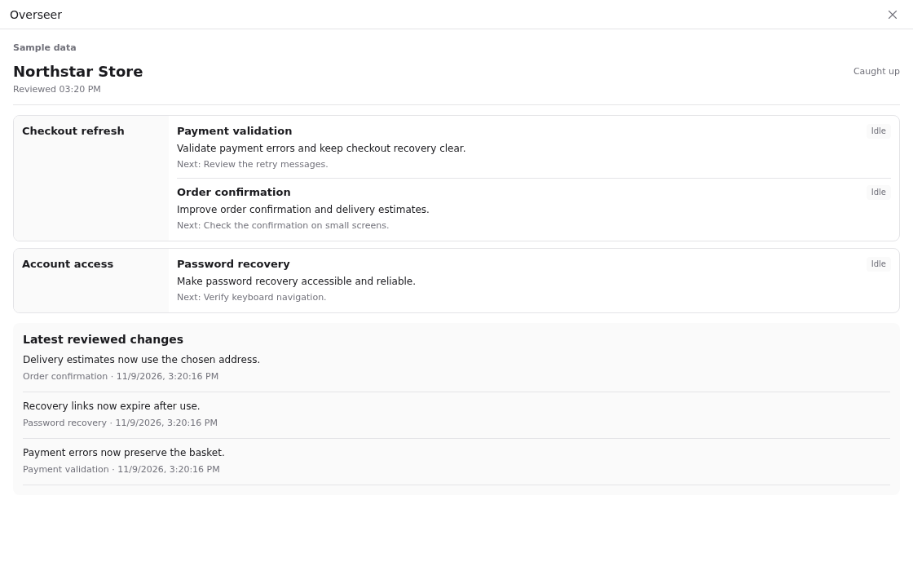

# Paseo Overseer


When several AI sessions share a project, it is easy to lose track of who owns what. Overseer gives you one view of each session's task and next step. It flags signs that two sessions are taking the same work or that a session is moving beyond your instructions.

It also gives vague tabs and workspaces useful names, so you can tell them apart without opening every chat. Reviews update as sessions grow, using a model you choose from your enabled Paseo providers.



## Install

Requires Paseo 0.15.1 or later, Node.js 22 or later, and an enabled, authenticated provider on the daemon host. Choose the review provider and model in Overseer settings. The default remains `codex/gpt-6-luna`; existing Codex selections are retained. Other providers use their Paseo configuration and credentials, without a separate Codex dependency.

Install from npm:

```sh
paseo plugin install npm:paseo-plugin-overseer
```

## Run locally

```sh
npm ci
npm run typecheck
npm test
paseo plugin install /absolute/path/to/paseo-overseer
```

Open **Overseer** in the sidebar or a workspace panel. Select projects in the plugin settings or the first-run project picker. Selection uses stable project IDs; saved name selections from earlier versions still work. No projects are selected on a new install. Concerns appear beside the sidebar item and in affected session composers while the client is connected.

## Observation

The default Brief view groups current work by workspace and session ownership. It includes next actions, latest concrete reviewed changes, explicit unresolved user decision requests, review backlog/failures, and historical coverage. A project selector appears when multiple projects are watched. Inbox sessions are kept behind a project-specific link, while actionable inbox requests remain visible. Unwatched sessions are omitted from current ownership; pausing observation shows last known work.

Compact Watch, Tab names, and Workspace names controls share the existing settings document and revision checks. Each shows On or Off. Their scope is all watched projects; an All projects label appears when more than one is configured. Pausing observation does not pause working agents. Desktop shows workspace names beside compact owner rows. Mobile stacks them. Long descriptions are limited to two lines in the brief; opening a session shows the full text. Additional owners can be expanded.

The brief is assembled from saved session analyses; it does not make project-level model calls. Existing session reviews also extract a concrete recent change and explicit unanswered assistant requests for the user's decision. Requests require matching assistant source quotes and are removed when answered. Activity timestamps come from the source timeline rather than the observer's review time. Older analyses default to empty change/request fields and fill on subsequent activity.

The daemon plugin owns agent and workspace list subscriptions, then subscribes to each selected session's live timeline. Events schedule bounded canonical history reads from a saved cursor. Reconnects recover from that cursor; timeline replacements invalidate old sequence positions and in-flight analysis. A long existing session starts with its opening and recent activity and remains marked as having incomplete history.

The store writes the cursor, pending activity, and summaries atomically. Matching fingerprints deduplicate replays and handle growing rows at the same sequence position. User requests remain in a separate bounded record alongside the model's summary. A failed analysis retains pending work for retry. One review runs at a time, with fair scheduling between sessions.

Each review runs through Paseo in a new private directory in a background workspace, with the provider and model chosen in settings. The helper is archived and its temporary project entry is removed after success, failure, timeout, or cancellation. The helper has no tab in your working workspace. Paseo retains archived background history according to its own rules; providers can also keep native logs. The plugin removes its temporary working directory after cleanup. Your provider's configuration and lifecycle hooks can apply to these helpers.

Every helper receives the same observer instructions and structured output schema. Claude tools are disabled; Codex uses read-only access with web search disabled; OpenCode permissions are denied. Other enabled providers use their configured permissions and the common no-tool instructions. A helper that requests permission is rejected and archived. Overseer does not grant it permission. Providers must return valid JSON matching the schema. Invalid output leaves the source activity pending for a later review. No fallback to a different provider occurs.

Every finding must cite matching source text; conflicts require evidence from both sessions. Matching a quote does not establish that the model's interpretation is correct.

## Names

The detail view applies suggested tab and workspace names. It checks the current name again before writing. Automatic workspace naming is on by default and has a separate settings switch. It names every unlocked workspace after its watched tabs finish review, including workspaces that already have descriptive names. No per-workspace opt-in is needed. The selected model derives one shared workspace name from all tab purposes and scopes together. Renames are at least 30 minutes apart, unchanged context is not sent for repeated naming calls, and concurrent requests are serialized. Lock workspace name preserves a name; Unlock workspace name makes it eligible again. An external name change persists a lock across restarts.

Automatic tab naming is off by default. When enabled, it changes only generic names or names previously set by Overseer. An external tab name change locks further automatic changes. Existing naming plugins are not disabled.

## Usage

Open **Usage** beside **Sessions**, or use **Open Overseer usage** in Command Center. The view shows reported token totals, cached input, reasoning output, call status, call time, payload sizes, daily totals, recent calls, and project/purpose breakdowns. Period filters use UTC. Cache is a subset of input, and reasoning is a subset of output; neither is added twice to total tokens. Account billing and plan limits are not inferred from token counts.

`usage.json` under the plugin data directory stores usage metadata only, including provider and model identity. Every model attempt is saved before execution and finalized after success, failure, or cancellation. Failed calls can still contribute reported tokens. Abandoned running entries become interrupted after restart; missing time and token data stay unknown. Only Overseer's model calls are counted. Native provider token reports are used without estimates. Missing fields stay unknown. Cost is shown only when the provider reports it. Tracking starts on the first run of this version; earlier calls cannot be recovered. Retention keeps the latest 300 completed call details and lifetime daily aggregates. The UI shows the latest 30 call details and 30 active days in the selected period.

Token fields follow the Paseo provider usage contract. The standalone Codex smoke test also checks CLI JSON usage events. Activity payload bytes measure the JSON supplied by Overseer, and Response bytes measure the returned analysis text, not total network traffic. Call time includes local helper startup and model execution. Failed token parsing does not turn unknown usage into zero usage.

## Checks

```sh
npm test -- --reporter=json --outputFile=/tmp/overseer-tests.json
npm run test:providers
```

The provider smoke test reviews synthetic activity through Claude Haiku and Codex Luna using Paseo. It requires both providers to be ready. Pass explicit `provider/model` arguments to test other enabled models. Results are saved in `/tmp/overseer-provider-smoke-tests.json`; usage is saved separately. `npm run test:smoke` retains the standalone Codex CLI checks for the observer prompt and evidence behavior.

Unit and integration tests cover durable replay, streaming row changes, source evidence, bounded batches, stale epochs, model failures, project isolation, and manual-name classification. They use temporary storage and do not alter live sessions.

## Limits

Alerts are advisory. There is no automatic interruption, reassignment, or permission override. Historical bootstrap can omit middle activity; individual activity rows are excerpted at 6,000 characters. Peer evidence is limited to recent excerpts and summaries. Live subscriptions restore after reconnect, but a daemon history gap cannot be reconstructed from a model summary. Selected activity goes to the selected provider using its Paseo configuration. State files stay under `$PASEO_HOME/plugin-data/overseer` with private file permissions.

The connection adapter uses the installed Paseo CLI's connection setup because the plugin server API does not expose a standing connection at startup. It is tested against Paseo 0.15.1. It needs revalidation when that internal CLI setup changes.

## Preview and release

Command Center → **Preview Overseer with sample data** renders the real brief with synthetic content, without model calls or actions on sessions. Public screenshots must use this view, cropped to the plugin panel.

`npm run check:package` checks the npm archive contents. `npm pack --pack-destination /tmp` creates a local release archive. Publication is separate from these checks. No runtime dependency download or build is required. Paseo compiles the TypeScript entry points.

The connection adapter is tested on Linux. macOS and Windows have not been verified. It relies on the installed Paseo CLI internal connection module, so newer Paseo releases need a compatibility check.

## License

MIT. The Codex configuration and skill-isolation approach includes code adapted from [paseo-chat-titles](https://github.com/iarmankhan/paseo-chat-titles) by Arman Khan. See LICENSE.
